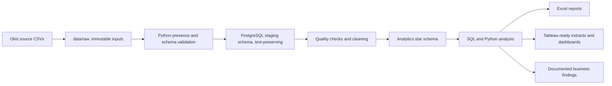

# Marketlytics

**End-to-End E-Commerce Business Intelligence & Customer Analytics Platform**

Marketlytics is a reproducible portfolio project for integrating the Brazilian E-Commerce Public Dataset by Olist, validating its quality, and building a trustworthy analytical foundation for sales, customer, product, geographic, and operational analysis.

> **Current status:** The PostgreSQL staging and analytics model, seven SQL analysis topics, Python EDA, reproducible figures, and an Excel business report are implemented and validated against the supplied Olist extract. SQL, Python, Excel, and Tableau Public deliverables are complete, and both published dashboards passed final visual review.

## Business problem and proposed solution

Olist's public data is split across orders, order items, customers, products, sellers, payments, reviews, and geographic reference data. Those files have different grains; joining them carelessly can multiply revenue and order counts. Marketlytics documents each grain, preserves source data, validates relationships, and builds analysis-ready models before producing business insights.

## Architecture



PostgreSQL staging stores source fields as text to avoid lossy inference and preserve source values. Typed parsing, business rules, and dimensional modeling belong in later phases. Staging loads replace the corresponding staging tables on each successful run and run in a transaction.

## Dataset

Download the **Brazilian E-Commerce Public Dataset by Olist** from [Kaggle](https://www.kaggle.com/datasets/olistbr/brazilian-ecommerce) and place these nine CSVs directly under `data/raw/`:

1. `olist_customers_dataset.csv`
2. `olist_geolocation_dataset.csv`
3. `olist_order_items_dataset.csv`
4. `olist_order_payments_dataset.csv`
5. `olist_order_reviews_dataset.csv`
6. `olist_orders_dataset.csv`
7. `olist_products_dataset.csv`
8. `olist_sellers_dataset.csv`
9. `product_category_name_translation.csv`

The project does not download, fabricate, or commit source records. The nine supplied CSVs are present locally under `data/raw/` and excluded from Git. Run `python scripts/check_data.py` to verify files, headers, and basic CSV readability before loading.

## Phase 1 setup

Requirements: Python 3.10+, Docker Desktop with Docker Compose, and the nine CSV files above. PostgreSQL runs in a Docker container; a native PostgreSQL installation is not needed.

```powershell
py -m venv .venv
.\.venv\Scripts\Activate.ps1
python -m pip install -r requirements.txt
Copy-Item .env.example .env
# Edit .env and replace PGPASSWORD with a private local password.
docker compose up -d db
docker compose ps
Get-Content database/schema.sql -Raw | docker compose exec -T db psql -U marketlytics -d marketlytics
python scripts/check_data.py
python scripts/load_staging.py
Get-Content database/analytics_model.sql -Raw | docker compose exec -T db psql -v ON_ERROR_STOP=1 -U marketlytics -d marketlytics
Get-Content database/validation.sql -Raw | docker compose exec -T db psql -v ON_ERROR_STOP=1 -U marketlytics -d marketlytics
.\scripts\run_analytics_sql.ps1
```

`check_data.py` is read-only and emits a machine-readable validation report in `logs/`. `load_staging.py` revalidates inputs and then replaces the nine `staging` tables in one transaction. It reads credentials only from environment variables (or `.env` for local development), never from source code. Do not commit `.env` or raw data. Docker stores the database in a named volume; `docker compose down` stops the service while preserving the volume. Avoid `docker compose down -v` unless you intend to delete the database data.

The Compose service creates a `marketlytics` user and database from `.env`. The host connection is `localhost:5434` in the current local setup because ports 5432 and 5433 were already occupied; change `POSTGRES_PORT` in `.env` if needed.

## Repository map

| Path | Purpose |
|---|---|
| `data/raw/` | User-provided source CSVs; ignored by Git |
| `data/processed/` | Reproducible derived extracts |
| `database/` | PostgreSQL schemas, constraints, validation, and ER artifacts |
| `sql/` | Documented analytical SQL, organized by topic |
| `src/` | Reusable ingestion, cleaning, transformation, analysis, and visualization modules |
| `notebooks/` | Narrated, reproducible analysis notebooks |
| `excel/` | Business analysis workbooks |
| `tableau/` | Tableau extracts, calculated fields, dashboard specifications, and previews |
| `visualizations/` | Saved analytical charts |
| `reports/` | Findings and recommendations supported by computed results |
| `tests/` | Data and analytical integrity checks |
| `logs/` | Local run and validation logs |
| `PROJECT_STATUS.md` | Phase checklist and current blockers |

## Implemented analytical model

The implemented dimensional model defines grain explicitly: `fact_orders` (one row per order), `fact_order_items` (one per order item), `fact_payments` (one per payment installment), and `fact_reviews` (one per review record), with customer, product, seller, date, and geography dimensions. Since orders, items, payments, and reviews have different grains, metrics will be aggregated at their correct grain before combining. The ER diagram and grain/fan-out decisions are documented in `database/er_diagram/star_schema.md`; model row counts and key measures were validated against staging.

## Roadmap

See [PROJECT_STATUS.md](PROJECT_STATUS.md) and [data/documentation/IMPLEMENTATION_PLAN.md](data/documentation/IMPLEMENTATION_PLAN.md) for the phase plan and completion evidence. Tableau dashboards: [Marketlytics Sales and Customer Retention](https://public.tableau.com/views/MarketlyticsSalesandCustomerRetention/CustomerRetention?:language=en-GB&:sid=&:redirect=auth&:display_count=n&:origin=viz_share_link). Evidence-based findings are documented in `reports/initial_findings.md`.

## Limitations

This is a public historical dataset with documented coverage and field limitations. Its records do not establish causality, and public customer identifiers do not represent verified real-world identities. Analytical definitions, exclusions, null handling, and date boundaries will be documented with each result.


