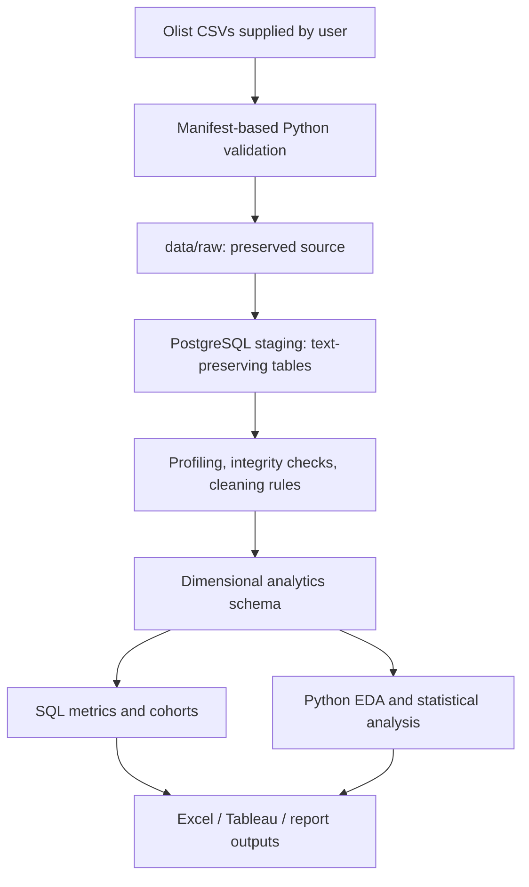

# Implementation plan and architecture

## Architecture

## Phases and acceptance criteria

1. **Repository and staging foundation:** create the modular layout; document data acquisition; verify all nine file names and expected headers; preserve raw files; create PostgreSQL schemas and text staging tables; make loading transactional and repeatable; log results. Complete before proceeding to transformations.
2. **Profiling, cleaning, modeling:** profile actual data, record quality findings and explicit handling decisions, parse timestamps and types, validate keys, define fact grains/dimensions, and document ER/star schemas. Preserve meaningful missingness.
3. **Advanced SQL:** add topic-organized queries for sales, customers, products, geography, operations, and cohorts; show joins, CTEs, windows, date trends, and checks for fan-out.
4. **Python EDA:** implement reusable profiling, RFM, cohort, trend, and comparison analyses, with notebooks as a narrative layer.
5. **Visualization:** generate labeled, analytically motivated charts from real data and save reproducible figures.
6. **Excel:** generate analysis-ready sheets and reports; clearly distinguish pivot-ready summaries from native PivotTables.
7. **Tableau:** publish documented source extracts, field definitions, and five dashboard specifications; claim a workbook only if Tableau actually creates one.
8. **Insights and polish:** publish only measured findings, assumptions, limitations, recommendations, and validation evidence; review setup and reproducibility.

## Phase 1 operational flow

1. Download the Olist dataset from Kaggle and put the nine named CSV files directly into `data/raw/`.
2. Run `python scripts/check_data.py`. The script checks presence and exact expected headers (extra columns are reported), duplicate/blank header names, parseability, and row count. A failing preflight exits nonzero and does not connect to PostgreSQL.
3. Configure `.env` using `.env.example`; create the target database and run `database/schema.sql` once.
4. Run `python scripts/load_staging.py`. It revalidates every source, creates/replaces staging tables in one database transaction, preserves values as text, and writes a JSON run record.

Staging reload is an intentional full replacement, not an append. Raw files remain untouched. Logs can include source file names and row counts but no credentials.
