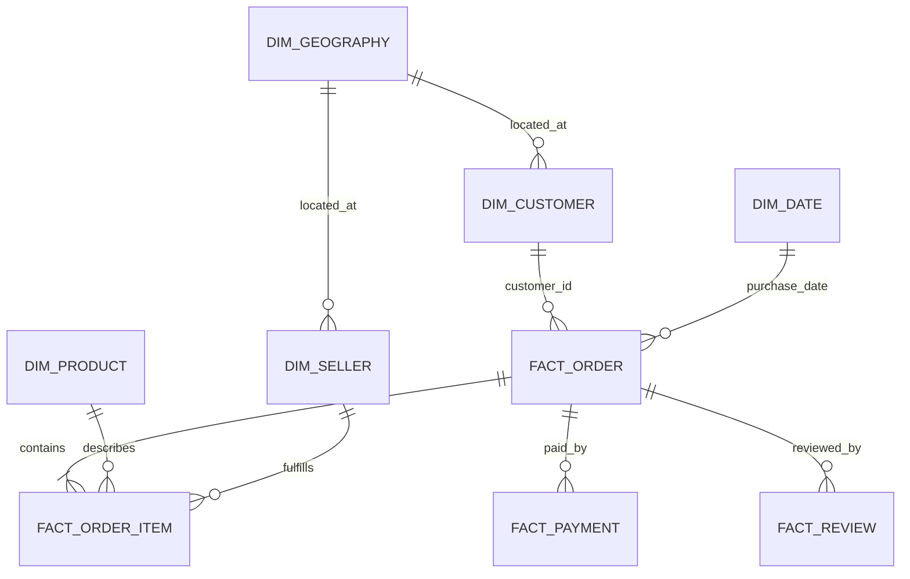

# Marketlytics analytical model

## Grain and join rules

| Table | Grain | Key | Main use |
|---|---|---|---|
| `dim_customer` | One source `customer_id` record. Olist assigns a fresh `customer_id` to an order context; `customer_unique_id` identifies the repeat-purchase account and repeats. | `customer_id` | Order-linked customer attributes and stable account identifier for RFM/cohorts |
| `dim_product` | One product | `product_id` | Category and product attributes |
| `dim_seller` | One seller | `seller_id` | Seller attributes and seller location |
| `dim_geography` | One normalized ZIP-prefix/state pair | (`zip_prefix`, `state`) | Coordinates and regional lookup; unmatched source locations retained with null coordinates |
| `dim_date` | One calendar day | `date_key` (`YYYYMMDD`) | Role-playing purchase, approval, shipping, delivery, and estimate dates |
| `fact_order` | One row per order | `order_id` | Order status, customer, lifecycle timestamps, delivery metrics |
| `fact_order_item` | One order line | (`order_id`, `order_item_id`) | Item price, freight, product, and seller |
| `fact_payment` | One payment sequence within an order | (`order_id`, `payment_sequential`) | Payment method, installment count, and payment value |
| `fact_review` | One review record | (`review_id`, `order_id`) | Score and optional comment text |

The profile found 814 repeated rows when `review_id` alone was treated as a key, while (`review_id`, `order_id`) has no duplicates. The review fact therefore uses the composite key. Multiple review records can belong to one order.

## Relationships

`customer_unique_id` is an account identifier carried on the customer dimension, not its primary key: the source contains 99,441 customer rows but 96,096 unique account IDs. Thirty-nine unique accounts are associated with multiple states, so the model preserves the order-context customer row and uses the stable ID only when grouping customer behavior. This avoids arbitrarily choosing one location for a repeat customer.

The source geolocation file has many coordinate observations per ZIP prefix and eight ZIP prefixes associated with multiple states. Geography is normalized on ZIP prefix plus state; latitude/longitude are summarized at that grain. Customers and sellers with no source geolocation match remain represented with null coordinates. Profiling found 278 customer rows and 42 seller rows without a matching ZIP-prefix/state record.

## Fan-out prevention

Never join raw `fact_order_item`, `fact_payment`, and `fact_review` rows together and sum their measures. First aggregate each fact to the target grain:

- Revenue and freight: aggregate order items by order, product, seller, or date as needed. Revenue is `SUM(price)`; freight is `SUM(freight_value)` and remains separate.
- Payment value: aggregate payment sequences by order before joining to orders or items.
- Review metrics: aggregate reviews by order before joining to an order-level report.
- Distinct orders: count `order_id` from `fact_order`, or from a fact using `COUNT(DISTINCT order_id)`.
- Average order value: aggregate item revenue by order, then average those order totals. Do not average item rows or payment rows.

## Field and missingness rules

- Preserve source CSVs and text-valued staging unchanged.
- Parse timestamps and numeric values into typed analytics columns; retain original blanks as SQL `NULL`.
- Missing delivery dates remain missing. A missing delivered timestamp is not zero delivery days and is excluded from delivered-order duration denominators.
- Missing product category is labeled `Unknown` in analysis output while the source null remains traceable.
- Review comments are optional text; review scores are retained independently of comment presence.
- Olist does not provide costs, returns, or complete accounting adjustments. Do not calculate profit from these tables.
